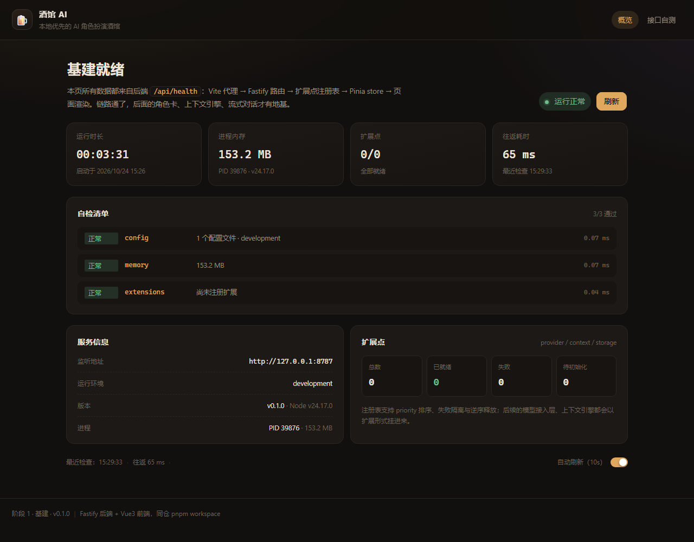
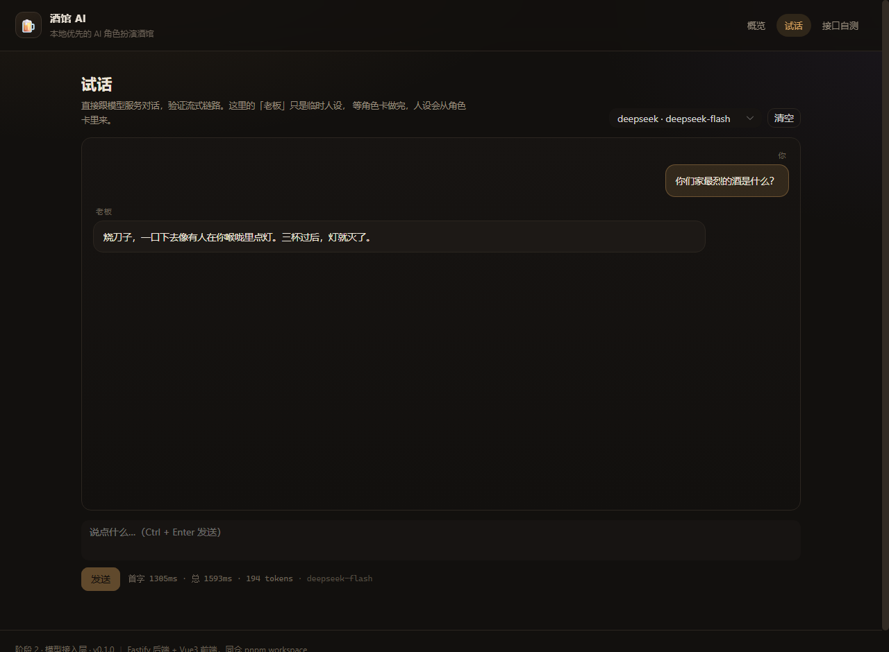

# 酒馆 AI（Tavern AI）

本地优先的 AI 角色扮演酒馆：角色卡、世界书、分支对话、流式输出，会话数据全部留在自己机器上。
浏览器打开地址即用，不需要装客户端。

**技术栈**：Vue3 + Vite + Pinia + Naive UI ｜ Fastify + TypeScript ｜ pnpm workspace 单仓



---

## 当前进度

### 阶段 1「基建」✅ 已完成

| 能力 | 状态 | 说明 |
|---|---|---|
| pnpm 单仓（server / web / shared） | ✅ | 共享契约走 `packages/shared`，前后端同一份类型 |
| 后端骨架与统一响应信封 | ✅ | 全局错误处理、traceId、分层目录 |
| `/api/health` 自检接口 | ✅ | 配置来源、内存、扩展点统计，单项失败不拖垮整体 |
| 扩展点注册表 | ✅ | 五类扩展、priority 排序、失败隔离、逆序释放 |
| 分层配置（yaml + env + zod） | ✅ | 合并顺序可追踪，写错字段启动即报错 |
| 前端骨架与联调 | ✅ | 深色酒馆风、健康状态卡片、自动刷新、404 兜底 |
| 生产单端口托管前端 | ✅ | `pnpm build && pnpm start` 后只在 8787 开整站 |

### 阶段 2「模型接入层」✅ 已完成

| 能力 | 状态 | 说明 |
|---|---|---|
| provider 适配器接口 | ✅ | chat / stream 双通道，能力位声明，与扩展点共用生命周期 |
| OpenAI 兼容实现 | ✅ | OpenAI、DeepSeek、中转站、本地 Ollama 走同一套协议 |
| SSE 流式解析 | ✅ | 逐行状态机处理分片、多事件、CRLF、心跳与中文切字节 |
| 首字超时与取消 | ✅ | 30 秒无首字判卡死；用户点停止立刻中断上游 |
| 配置化注册 | ✅ | `providers` 段声明即可，密钥支持 `apiKeyEnv` 从环境读 |
| 错误归一层 | ✅ | 401/404/429/5xx 映射成带语义错误码，可重试标记 |
| 试话面板 | ✅ | 浏览器里逐字输出，实时显示首字延迟 / 总耗时 / token |



后续阶段（角色卡、上下文引擎、分支聊天、记忆与群聊、导入导出）见 [docs/git-workflow.md](docs/git-workflow.md) 的提交计划。

---

## 快速开始

**前置要求**：Node.js ≥ 20.10、pnpm ≥ 9。

```bash
pnpm install          # 装依赖（shared 会自动编译一次）
pnpm dev              # 同时起后端 8787 与前端 5173
```

然后浏览器打开 **http://127.0.0.1:5173** —— 页面上的状态卡会实时显示后端健康情况。

也可以只起其中一端：

```bash
pnpm dev:server       # 只有后端，直接访问 http://127.0.0.1:8787/api/health
pnpm dev:web          # 只有前端（需要后端已在跑，否则状态卡显示「未连接」并给出排查建议）
```

### 生产形态（单端口）

```bash
pnpm build            # 依次构建 shared → server → web
pnpm start            # 后端托管 apps/web/dist
```

打开 **http://127.0.0.1:8787** 就是完整页面，不再需要 5173。
`/api/*` 未命中返回 JSON 404，其余路径回落到 `index.html` 交给 Vue Router（前端路由刷新不会白屏）。

---

## 常用命令

| 命令 | 作用 |
|---|---|
| `pnpm dev` | 并行启动后端 + 前端（含 shared 监听编译） |
| `pnpm dev:server` / `pnpm dev:web` | 单独启动某一端 |
| `pnpm build` | 构建全部包（拓扑顺序） |
| `pnpm start` | 以生产模式启动后端（需先 build） |
| `pnpm lint` / `pnpm lint:fix` | ESLint 检查 / 自动修复 |
| `pnpm format` / `pnpm format:check` | Prettier 格式化 / 校验 |
| `pnpm typecheck` | 全仓类型检查（后端 tsc，前端 vue-tsc） |
| `pnpm test` | 全部单元/集成测试 |

---

## 目录结构

```
.
├── apps/
│   ├── server/                  # 后端：Fastify + TypeScript
│   │   └── src/
│   │       ├── app.ts           # 组装应用（不 listen，便于 inject 测试）
│   │       ├── index.ts         # 入口：加载配置 → 建应用 → 监听 → 优雅退出
│   │       ├── config/          # schema（zod）+ loader（yaml/env 合并）
│   │       ├── core/extension/  # 扩展点类型、注册表、错误
│   │       ├── http/            # 信封、错误映射、路由、静态托管
│   │       ├── lib/             # 日志、运行时信息
│   │       └── types/           # Fastify 实例类型与 decorate 声明
│   └── web/                     # 前端：Vue3 + Vite
│       └── src/
│           ├── api/             # HTTP 客户端（超时 / 拆信封 / 错误归一）
│           ├── stores/          # Pinia：健康状态 + 自动刷新
│           ├── router/          # 路由与 404 兜底
│           ├── views/           # 页面
│           ├── styles/          # 主题变量与全局样式
│           └── utils/           # 格式化工具
├── packages/
│   └── shared/                  # 前后端共享契约（zod schema + 类型 + 常量）
├── config/
│   ├── default.yaml             # 出厂配置（随代码提交）
│   └── user.example.yaml        # 个人配置模板 → 复制为 user.yaml（已 gitignore）
└── docs/                        # 架构说明、提交规范、截图
```

---

## 配置

三层合并，**后者覆盖前者**：

```
内置默认值（schema） → config/default.yaml → config/user.yaml → 环境变量
```

- 个人改动写 `config/user.yaml`（已被 `.gitignore` 忽略，可以放 API Key）：

  ```bash
  cp config/user.example.yaml config/user.yaml     # Windows: Copy-Item
  ```

- 环境变量按「前缀 + 双下划线」映射到配置路径：

  ```bash
  TAVERN_SERVER__PORT=9000        # server.port
  TAVERN_LOGGING__LEVEL=debug     # logging.level
  TAVERN_FEATURES__PLUGINS=true   # features.plugins
  PORT=9000                       # 兼容 PaaS 惯例，等价于 server.port
  NODE_ENV=production             # 等价于 app.env
  ```

- 配置写错（字段拼错、类型不对、YAML 语法错）会**在启动第一秒**打印具体文件与字段，并以退出码 1 结束，不会等到运行时才炸。

### 接一个模型服务

在 `config/user.yaml` 里加一段（DeepSeek 为例，真实模型 id 是 `deepseek-flash`）：

```yaml
providers:
  - name: deepseek
    type: openai-compatible
    baseUrl: https://api.deepseek.com/v1
    model: deepseek-flash
    apiKey: sk-xxxxxxxx          # 本文件不入库
    # 更稳妥：删掉 apiKey，改用 apiKeyEnv: DEEPSEEK_API_KEY
    priority: 10
```

重启后端，打开 `/playground` 就能对话。注意：`providers` 里任意一家 OpenAI 兼容服务都行（OpenAI 官方、通义、Moonshot、本地 Ollama 的 `/v1`、各类中转站）。

字段含义见 [config/default.yaml](config/default.yaml)，权威定义见 `apps/server/src/config/schema.ts`。

---

## 接口

所有响应统一包裹信封；失败时 `ok: false`，`error.code` 是稳定可编程的错误码（`NOT_FOUND`、`VALIDATION_FAILED`、`UPSTREAM_ERROR`…），`error.message` 面向用户。

### `GET /api/health` —— 自检

```jsonc
{
  "ok": true,
  "traceId": "c43567a7-…",          // 与日志中的 reqId 一致
  "data": {
    "status": "ok",                  // ok | degraded
    "app": { "name": "酒馆 AI", "version": "0.1.0", "env": "development", "uptimeSeconds": 12.5, … },
    "server": { "host": "127.0.0.1", "port": 8787, "pid": 1234, "memoryMb": 168.7 },
    "extensions": { "total": 0, "ready": 0, "failed": 0, "pending": 0 },
    "checks": [ { "name": "config", "status": "ok", "message": "1 个配置文件 · development", "latencyMs": 0.25 } ]
  }
}
```

### `GET /api/providers` —— 模型服务列表

```jsonc
{ "ok": true, "data": [
  { "name": "deepseek", "model": "deepseek-flash", "state": "ready",
    "capabilities": ["streaming", "usage"], "hasCredentials": true }
]}
```

### `POST /api/chat` —— 一次性对话

```bash
curl -X POST http://127.0.0.1:8787/api/chat \
  -H 'content-type: application/json' \
  -d '{"messages":[{"role":"user","content":"你好"}]}'
```

### `POST /api/chat/stream` —— 流式对话（SSE）

请求体同上，响应是 `data: {json}` 帧序列：

```
data: {"type":"start","traceId":"…","provider":"deepseek","model":"deepseek-flash"}
data: {"type":"delta","text":"烧"}
data: {"type":"delta","text":"刀子"}
data: {"type":"usage","usage":{"promptTokens":45,"completionTokens":119,"totalTokens":164}}
data: {"type":"done","finishReason":"stop","durationMs":1593,"firstTokenMs":1305,"usage":{…}}
```

出错时以 `{"type":"error","code":"RATE_LIMITED","message":"…","retryable":true}` 收尾。前端用 `fetch` + `ReadableStream` 读，不用 `EventSource`（它只支持 GET）。

---

## 质量门禁

```bash
pnpm lint && pnpm typecheck && pnpm test
```

当前基线：ESLint 0 error、类型检查 0 error、**87 个用例**全绿（配置 19 / 扩展点 9 / SSE 11 / OpenAI 适配器 19 / provider 工厂 8 / 健康检查 5 / 静态托管 8 / 对话路由 8）。

---

## 文档

- [架构说明](docs/architecture.md) —— 分层、请求生命周期、扩展点体系、关键取舍
- [提交规范](docs/git-workflow.md) —— 提交粒度、信息格式、34 次提交计划

## 说明

本项目用于学习与自用。模型服务需要自备 API Key（或本地推理服务），密钥只存在本机 `config/user.yaml`，不会进仓库。
