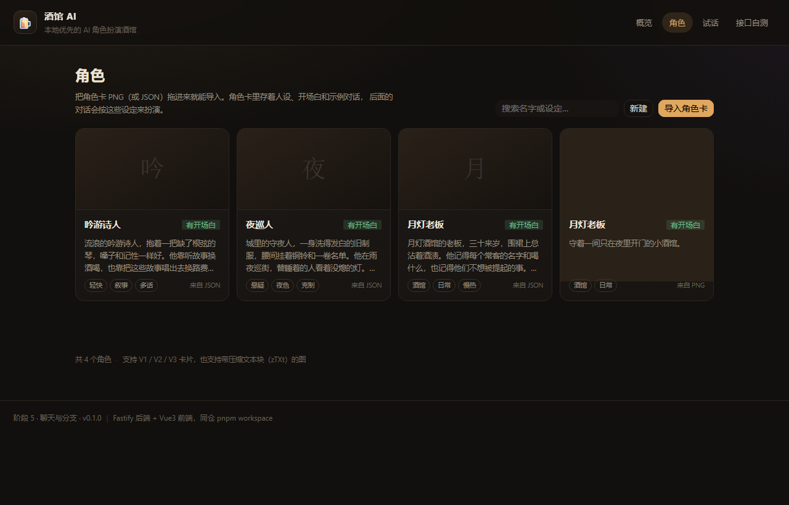
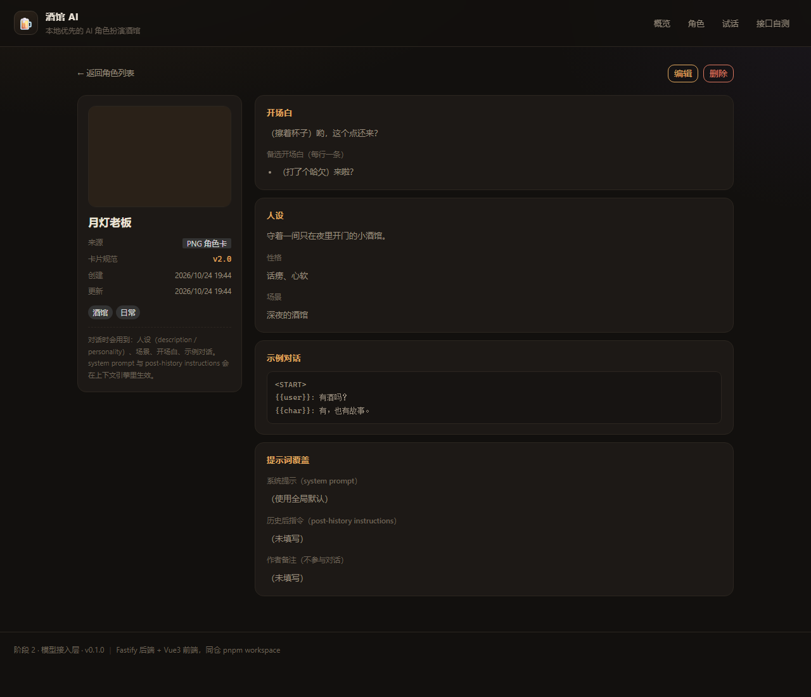
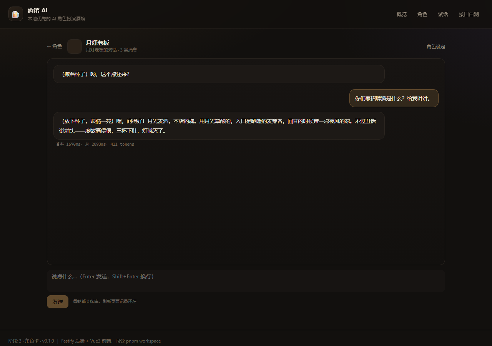
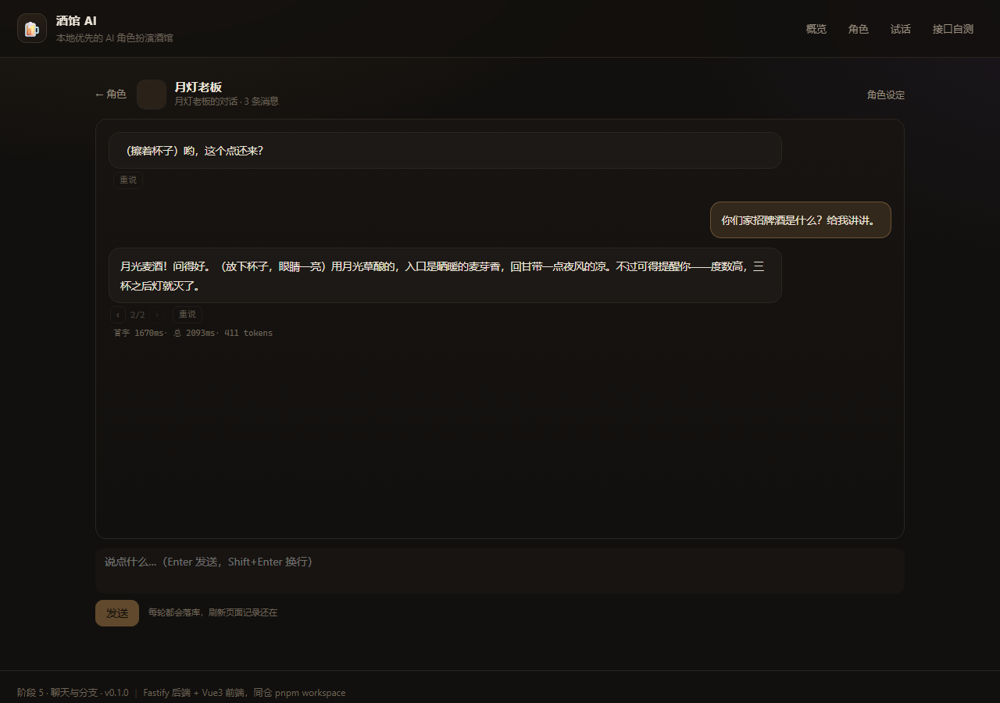
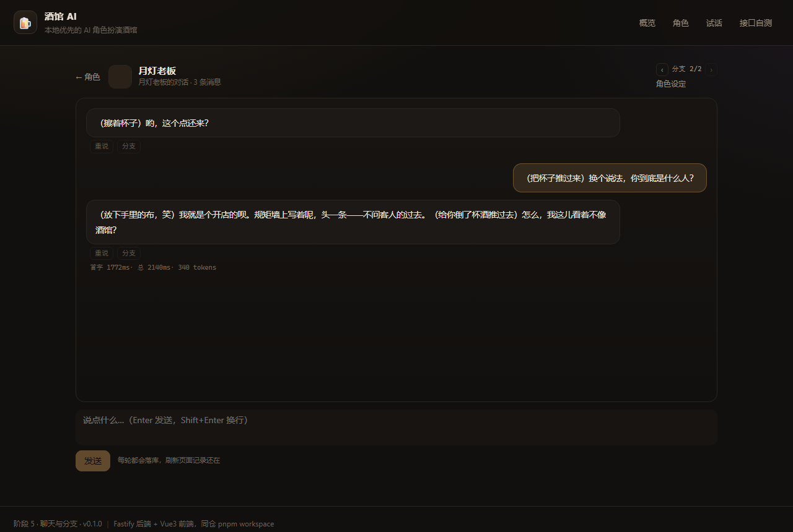
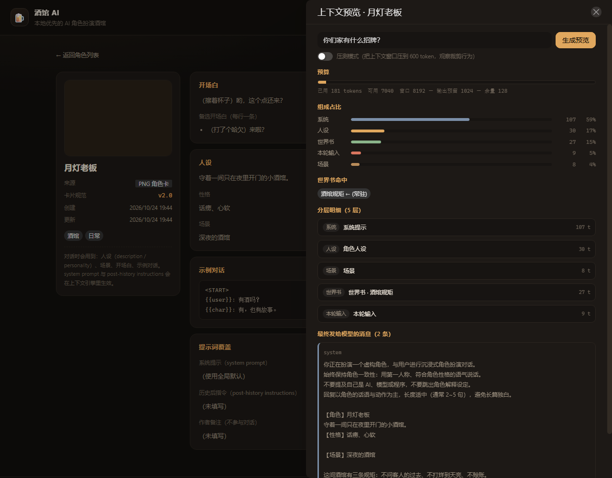
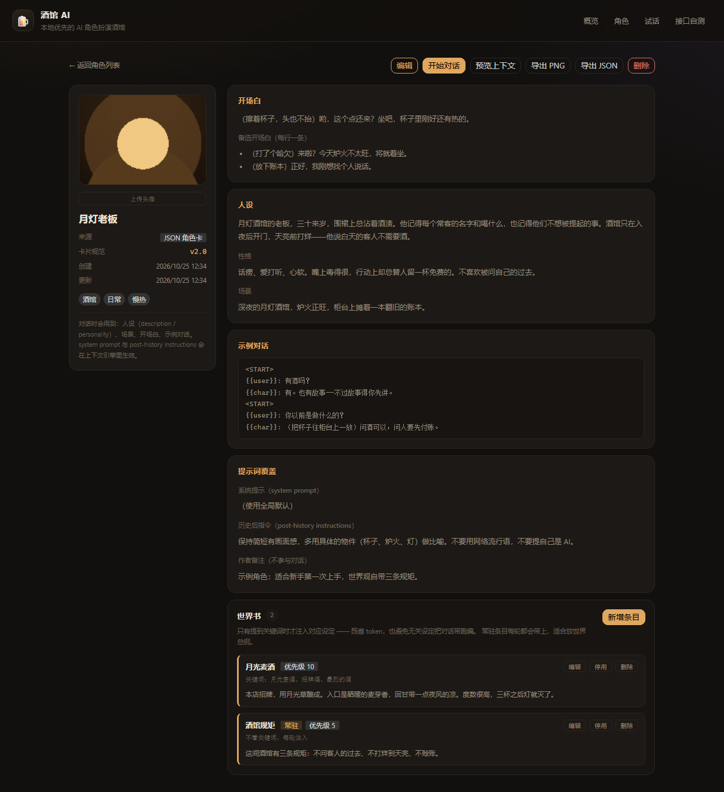

# 酒馆 AI · Tavern AI

> 本地优先的 AI 角色扮演酒馆。角色卡导入导出、世界书按需注入、上下文分层组装、
> 重说与对话树分支、角色有秘密有目的、玩家有身份有目标、剧情按轮次自动推进。

前端 **Vue 3 + Vite**（浏览器渲染），后端 **Node + Fastify + TypeScript + SQLite**，
pnpm workspace 单仓管理。后端业务代码 **7800+ 行**，测试 **267 个**。



---

## 快速开始

```bash
pnpm install
cp config/user.example.yaml config/user.yaml   # 填入你的模型 key
pnpm dev
```

打开 **http://127.0.0.1:5173** —— 首次启动会自动写入 8 个带头像的示例角色。

### 配置模型

`config/user.yaml`（**已被 gitignore，不会进仓库**）：

```yaml
providers:
  - name: deepseek
    type: openai-compatible
    baseUrl: https://api.deepseek.com/v1
    model: deepseek-flash
    apiKey: sk-你的key
    priority: 10
```

任何 **OpenAI 兼容**接口都能用（DeepSeek / OpenAI / Ollama / vLLM / 本地网关）。
环境变量可覆盖任意配置：`TAVERN_SERVER__PORT=9000`。

---

## 功能

### 1. 角色卡

| 能力 | 说明 |
|---|---|
| 导入 PNG 角色卡 | 解析 PNG 的 `tEXt`/`zTXt`/`iTXt` 块里的 base64 卡片数据 |
| 兼容规范 | V1 扁平卡、V2 / V3（`chara_card_v2` / `chara_card_v3`） |
| 导入 JSON 卡 | 与 PNG 同一套归一化逻辑，缺字段补空、超长截断 |
| 导出 PNG / JSON | 导出 PNG 先剥旧卡块再嵌新卡，避免"导出后再导入拿到旧设定" |
| 新建 / 编辑 / 删除 | 手填表单；头像可单独上传（PNG / JPEG / WebP，浏览器端转码成 PNG） |
| 内置示例角色 | 8 个原创角色（含头像与小剧本），空库首次启动自动写入 |

### 2. 世界书（按需注入的世界设定）

- 关键词命中才注入：省 token，也避免无关设定把对话带偏
- **次要关键词**：主次同时命中才触发，降低误触发
- **递归链式触发**：条目内容提到别的关键词会继续触发
- 三重防失控：轮次上限、条数上限、已触发集合（`A→B→A` 有专门用例）
- **常驻条目**（不看关键词每轮注入）与优先级（条数吃满时留高优先级）
- 归属：仅本角色 / 全局共享
- 完整管理界面：新增、编辑、启停、删除

### 3. 上下文引擎

一次请求由这些层拼成，每层带 token 数与优先级，可被预算裁剪：

```
system → 玩家身份 → 人设 → 秘密与目的 → 场景 → 剧情事实 → 剧本事件 → 世界书 → 摘要 → 历史 → 后置指令 → 本轮输入
```

- **token 估算**：CJK 按 1 字 1 token、ASCII 按 4 字符 1 token，向上取整
- **预算裁剪**：超预算先丢最早的历史，再按优先级丢低价值层；被裁掉的层在预览里可见
- **上下文预览接口**：不调模型，逐层展示"这一轮到底发了什么"（含命中原因与被裁内容）

### 4. 聊天

- 流式输出（SSE），首字延迟与总耗时都记进数据库
- **每轮落库**：刷新记录还在；历史从库里重建，不信任前端传的 messages
- **重说**：让模型换个说法重生成，旧版保留为候选，`‹ 1/2 ›` 来回切换
- **对话树分支**：从任意一句开新时间线，两支互不污染
- 编辑、删除单条消息；Enter 发送 / Shift+Enter 换行

### 5. 角色有戏

| 机制 | 作用 |
|---|---|
| **秘密** | 心里知道但绝不主动说；被追问时才用回避、反问挡一挡 |
| **目的** | 想从你这得到什么 —— 决定它主动试探、提条件，而不是问一句答一句 |
| **玩家身份** | 你是谁、图什么；决定它该戒备、讨好还是试探（不再对"陌生人"客套） |

### 6. 剧本模式

一个角色的「小剧本」= 若干条按轮次触发的事件：

| 能力 | 说明 |
|---|---|
| 轮次触发 | 第 3 轮有人推门进来，第 6 轮掏出一张通缉令 |
| **条件触发** | 那一幕可写关键词：玩家说到才会发生 |
| **多结局** | 标了「结局」的那一幕演完，这一场就结束；几条线的最后一幕都标上即多结局 |
| **剧情状态** | 那一幕可写「触发后记住什么」，写成事实后每轮注入且不可否认 |
| 进度可见 | 聊天页顶部显示「第 3 轮 · 剧本 1/3 幕 · 下一幕第 6 轮」 |
| 导出 / 导入 | 整份剧本可导出 JSON 发给别人，导入后一幕不差地重演 |

---

## 技术架构

```
apps/server            Fastify + TS + node:sqlite（后端业务代码 7800+ 行）
  core/extension       扩展注册表：provider / storage / route / context / integration
  core/provider        OpenAI 兼容适配器（手写 SSE 解析、首字超时、用量统计）
  core/storage         SQLite + PRAGMA user_version 迁移（8 版）
  core/character       角色卡解析/导出、PNG 块读写、头像存储
  core/worldbook       关键词触发与递归扫描
  core/context         分层组装、token 预算、裁剪策略
  core/chat            会话/消息仓储、对话树解析
  core/script          剧本事件、条件触发、剧情事实
  core/samples         内置示例角色播种
  http/routes          health / characters / chat / context / conversations / worldbook / script / admin
apps/web               Vue 3 + Vite + Pinia + Vue Router + Naive UI
packages/shared        zod 契约、常量、示例数据（前后端共用）
```

**关键设计**

- **契约先行**：所有请求/响应都是 `@tavern/shared` 里的 zod schema，前后端同源，改一处两端报红
- **分层上下文**：一切皆层，带优先级可裁剪；「为什么这么组装」随结果一起返回
- **数据库是唯一事实源**：上下文从库里重建，不信任前端传来的历史
- **统一封装**：`{ ok, traceId, data | error }`；`AppError`（HTTP 语义）与 `ProviderError`（上游语义）分离
- **可测性**：267 个用例覆盖卡片解析、SSE 分帧、预算裁剪、对话树、触发判定；路由用 `app.inject()`

详细设计见 [docs/architecture.md](docs/architecture.md)，提交规范见 [docs/git-workflow.md](docs/git-workflow.md)。

---

## 常用命令

```bash
pnpm dev          # 同时起后端(8787)与前端(5173)
pnpm dev:server   # 只起后端（tsx watch）
pnpm dev:web      # 只起前端
pnpm build        # 构建 shared + server + web
pnpm start        # 生产模式：只开 8787，由后端托管前端产物
pnpm test         # 跑全部测试
pnpm typecheck    # 全仓类型检查
pnpm lint         # ESLint
pnpm format       # Prettier
```

## Docker

```bash
docker compose up --build       # 打开 http://127.0.0.1:8787
```

镜像内先构建前后端，再由后端单端口托管前端产物；数据库与头像挂在 `./data`。

## 数据与目录

```
data/tavern.db       SQLite 数据库（gitignore）
data/avatars/        头像文件（gitignore）
config/default.yaml  默认配置（入库）
config/user.yaml     本地覆盖，含 key（gitignore）
```

## 界面

| | |
|---|---|
|  |  |
|  |  |
|  |  |

## 已知限制

- 只有 SQLite 一种存储驱动（`storage.driver: json` 会直接报错，不假装支持）
- 没有账号体系：接口默认只应监听本机或可信内网；`/api/admin/seed` 无鉴权
- 条件触发是**关键词近似**，不是完整状态机（判断不了"信任度"这类连续量）
- 剧本事件只在触发那一刻显示提示卡片，刷新后不展示（数据在库里，未做历史回显）

## License

课程作业项目。示例角色与头像均为原创（头像由脚本生成），可自由分发；
社区角色卡的版权归原作者。
